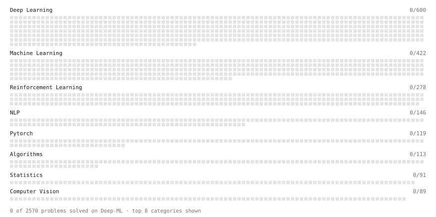

# Deep-ML

My machine learning practice from [Deep-ML](https://www.deep-ml.com). Every solution here was written by hand.

**4** solved · 0 problems · 0 labs · 4 math

[**Browse the interactive portfolio**](https://poornaravuri1108.github.io/deep-ml/) to replay this filling in over time.

## Math

| | Difficulty | Solved | |
| --- | --- | --- | --- |
| [Derivatives and Gradients](https://www.deep-ml.com/math-problems/1) | easy | 2026-11-24 | [solution](math/0001-derivatives-and-gradients) |
| [Descriptive Statistics](https://www.deep-ml.com/math-problems/18) | easy | 2026-11-24 | [solution](math/0018-descriptive-statistics) |
| [Gradient Descent Updates](https://www.deep-ml.com/math-problems/5) | easy | 2026-11-24 | [solution](math/0005-gradient-descent-updates) |
| [Probability Fundamentals](https://www.deep-ml.com/math-problems/19) | easy | 2026-11-24 | [solution](math/0019-probability-fundamentals) |

---

_This file is regenerated by Deep-ML on every push._
